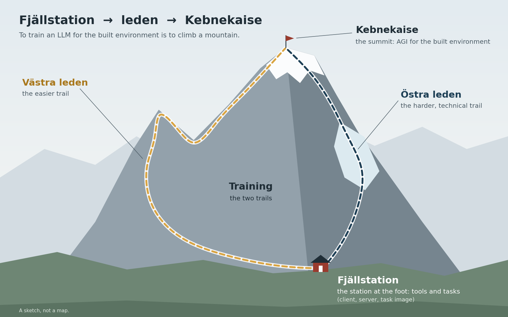

# Fjällstation

A tool kit to train LLM agents for the built environment: data loaders, a task environment and a reward server.



Fjällstation is the mountain station at the foot of Kebnekaise, where you prepare before the climb. This project is the station: it gives the tools and the tasks, and the training is yours. On PyPI its name is `nekaise`.

## What you get

| Part | What it does |
|---|---|
| `nekaise.Corpus()` | domain text for pretraining, as a Hugging Face dataset |
| `nekaise.Instruct()` | chats for fine-tuning, as a Hugging Face dataset |
| `nekaise.Env()` | modelling tasks in Modelica: a container to work in, and a reward |
| Task image | OpenModelica with the libraries of the tasks |
| Server | gives the tasks and the rewards |

You bring the data: one folder in a [simple format](https://github.com/zengpz/fjallstation/blob/main/docs/data.md). The same parts run on one workstation or on several machines.

## Quick start

You need Python 3.10 or later and Docker. Tested on Linux.

```bash
pip install nekaise
nekaise image                    # build the task image; the first build takes some minutes
nekaise example ./store          # a small example store, to try things
nekaise server --store ./store   # the server; keep it running in this terminal
```

Then, in a second terminal in the same folder, with Python:

```python
import nekaise                       # reads ./store, or the folder in NEKAISE_STORE

for doc in nekaise.Corpus():
    print(doc["text"])
for row in nekaise.Instruct():
    print(row["messages"])

env = nekaise.Env()
task = env.reset("example-heatedroom")   # a task and a fresh container; env.reset() gives a random task
print(task.prompt)
print(env.exec("omc --version").output)  # your agent works in the container

model = """
model HeatedRoom
  Real T(start = 10, fixed = true);
  output Real T_room;
equation
  2e6*der(T) = 1500 - 100*T;
  T_room = T;
end HeatedRoom;
"""
result = env.step(model)                 # the container tries the model; the server gives the reward
print(result.reward, result.feedback)    # 1.0 correct
```

## Documents

- [The data folder](https://github.com/zengpz/fjallstation/blob/main/docs/data.md): the format, and how to make tasks of your own.
- [One episode, step by step](https://github.com/zengpz/fjallstation/blob/main/docs/protocol.md): the same episode with a shell, who runs as whom, and use on several machines.
- [The reward](https://github.com/zengpz/fjallstation/blob/main/docs/scoring.md): the two parts of the reward and the rule behind them.

## Licence

Apache 2.0, see [LICENSE](https://github.com/zengpz/fjallstation/blob/main/LICENSE). The task image installs OpenModelica and Modelica libraries; they have their own licences.
